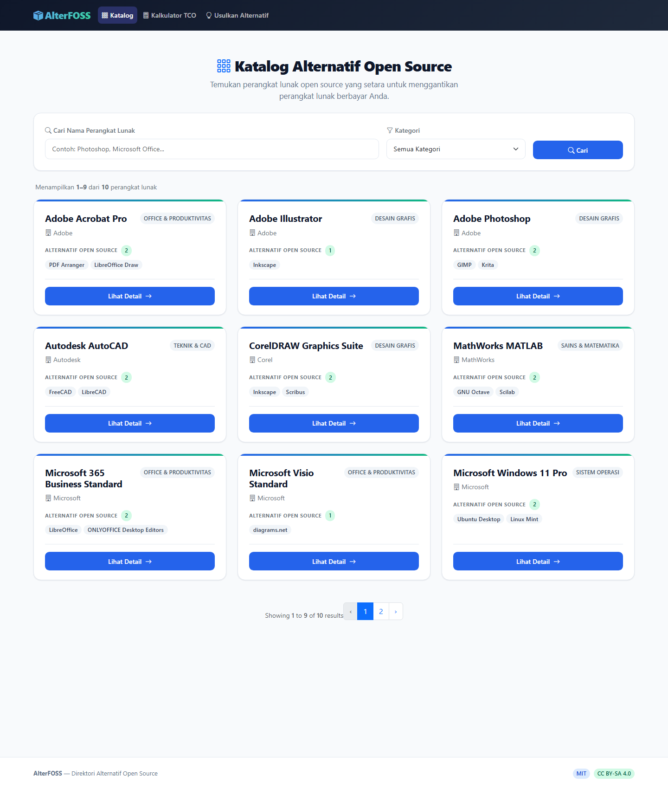
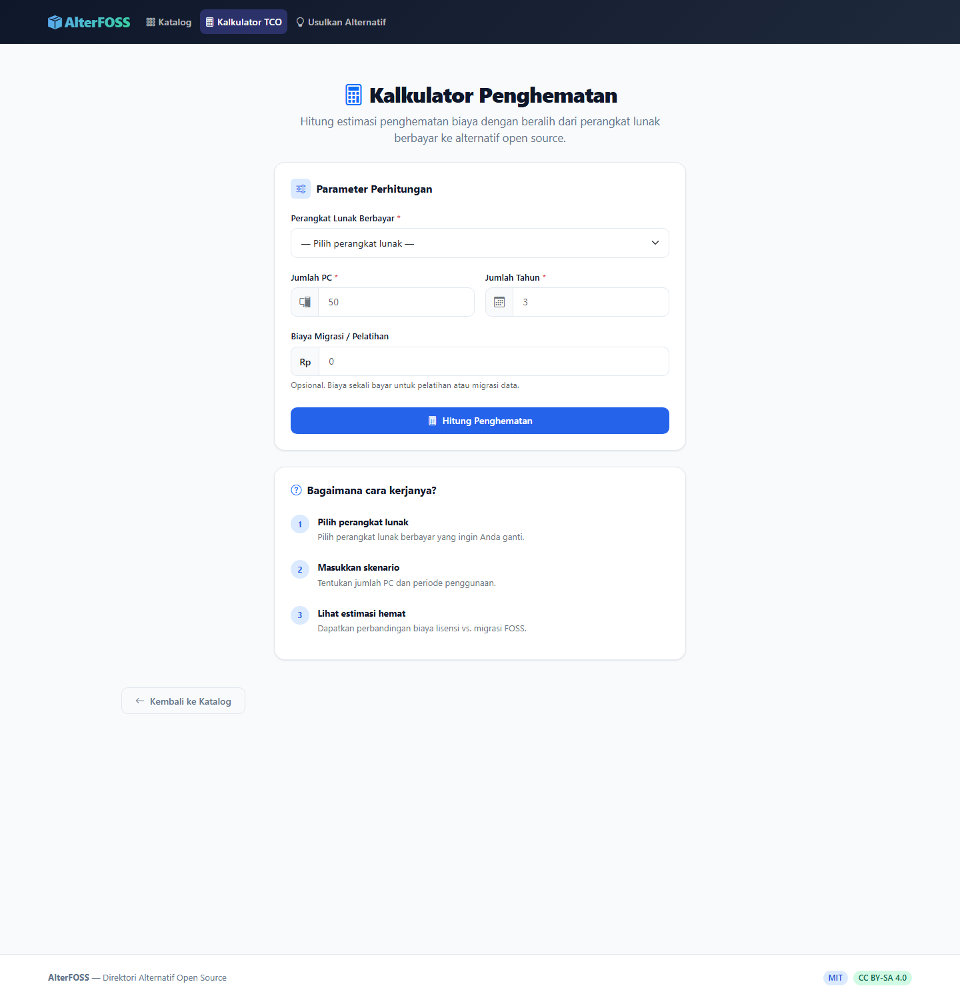
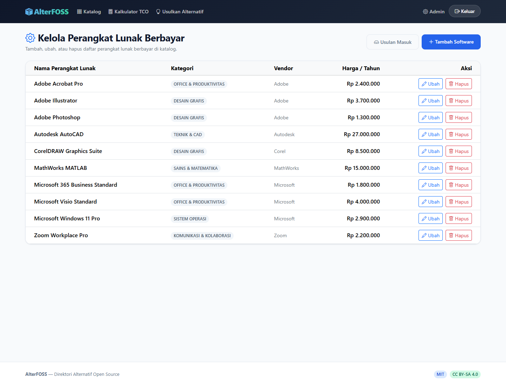

# AlterFOSS


> Direktori alternatif open source untuk perangkat lunak berbayar, lengkap dengan informasi
> lisensi, panduan migrasi, dan kalkulator penghematan biaya.

## Deskripsi

AlterFOSS membantu pengguna menemukan alternatif open source dari perangkat lunak berbayar.
Proyek akhir mata kuliah Open Source, Program Studi Sistem Informasi, UINSI Samarinda.

## Fitur Unggulan

- Katalog dan pencarian perangkat lunak berbayar beserta alternatif open source-nya
- Halaman detail: jenis lisensi dan panduan migrasi
- Kalkulator penghematan biaya (TCO sederhana)
- Panel admin untuk mengelola data perangkat lunak dan memoderasi usulan
- Formulir usulan alternatif baru dari pengunjung

## Prasyarat Sistem

- PHP **8.3 atau lebih baru** (ekstensi: mbstring, xml, pdo_mysql, curl, zip)
- Composer
- MySQL atau MariaDB (mis. dari XAMPP)
- Git

## Panduan Instalasi

```bash
git clone https://github.com/albukhorisofyan-ops/FOSS-Alternative.git
cd FOSS-Alternative
composer install
cp .env.example .env
php artisan key:generate
```

Buat database kosong bernama `alterfoss` (mis. lewat phpMyAdmin), lalu atur `.env`:

```
DB_CONNECTION=mysql
DB_HOST=127.0.0.1
DB_PORT=3306
DB_DATABASE=alterfoss
DB_USERNAME=root
DB_PASSWORD=
```

Buat tabel dan isi data awal:

```bash
php artisan migrate --seed
```

## Cara Menjalankan

```bash
php artisan serve
```

Buka http://127.0.0.1:8000 di browser.

**Login admin:** buka http://127.0.0.1:8000/login (tautannya tidak ditampilkan di menu).
Akun pengembangan: `admin@alterfoss.test` / `password`. Ganti sebelum dipakai di server sungguhan.

Menjalankan pengujian otomatis:

```bash
php artisan test
```

## Tangkapan Layar





## Kontribusi

Lihat [CONTRIBUTING.md](CONTRIBUTING.md).

## Lisensi

- Kode program: [MIT](LICENSE)
- Data direktori (daftar alternatif, deskripsi, panduan migrasi): CC BY-SA 4.0

## Kredit Tim Pengembang

| Nama | NIM | Peran |
|---|---|---|
| (Nama) | NIM | Database dan fondasi |
| (Nama) | NIM | Katalog dan pencarian |
| (Nama) | NIM | Kalkulator penghematan |
| (Nama) | NIM | Admin dan usulan |